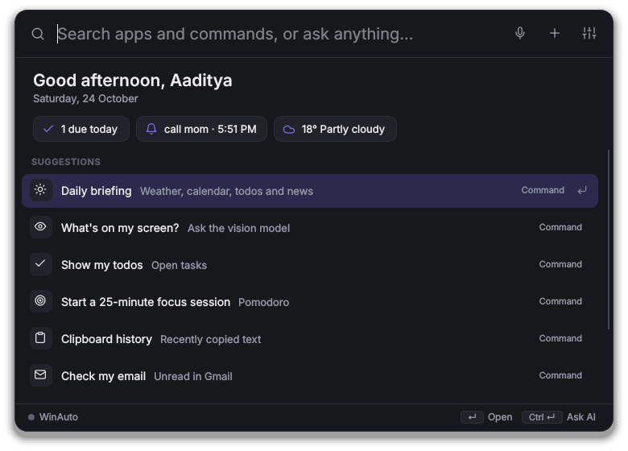
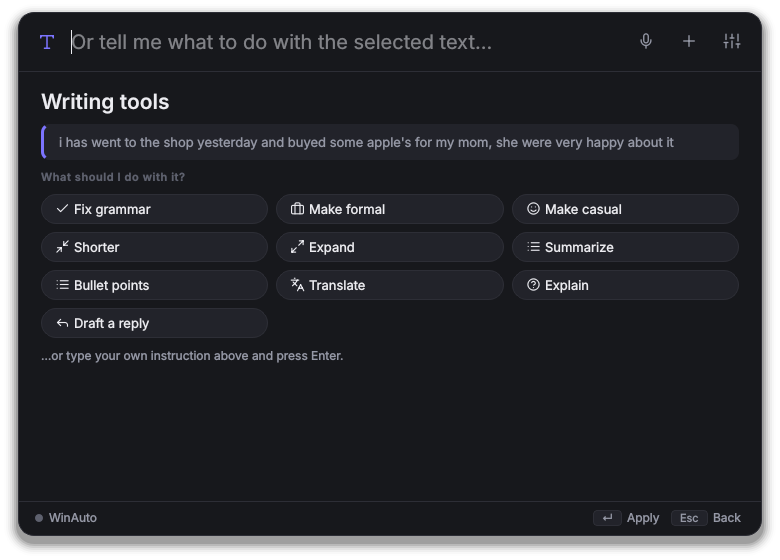
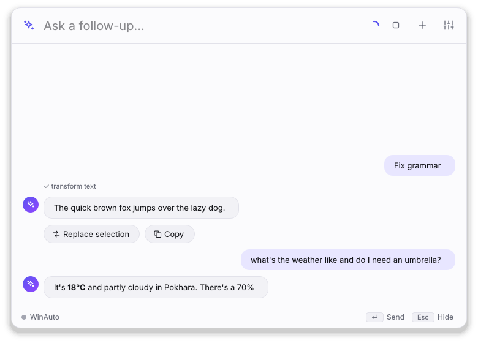

# WinAuto

A private assistant and launcher for your Windows PC. Press **Ctrl+Alt+Space** and start typing: apps, settings and commands appear as you type (like Raycast or PowerToys Run), or ask anything in plain English and it gets done. It opens apps, writes your emails and messages, keeps your todos and notes, reads your calendar, controls your PC, and more.

The AI runs **on your own PC** (via [Ollama](https://ollama.com)), so your requests don't go to anyone's cloud. Simple commands like `open spotify` or `volume 30` don't even need the AI; they run instantly.

| Launcher | Results as you type |
|---|---|
|  |  |
| **Writing tools on any selected text** | **Chat with streaming answers** |
|  |  |

## Launcher keys

| Key | Does |
|---|---|
| **Ctrl+Alt+Space** | Open or hide WinAuto (from any app) |
| **Ctrl+Alt+T** | Writing tools for the text you've selected in any app |
| ↑ ↓ and **Enter** | Choose a result and run it |
| **Ctrl+Enter** | Ask the AI instead |
| **Esc** | Clear, then hide |
| `>` command | Run a terminal command (asks first), e.g. `> ipconfig` |
| `:` word | Find an emoji and copy it, e.g. `:party` |
| `/` name | Find files by name, e.g. `/resume` |
| `clip` | Clipboard history |
| `#ff8800` | Colour in hex, rgb and hsl |
| `12*7`, `10 km to miles` | Answer appears instantly; Enter copies it |

## What it can do

| Area | Try saying |
|---|---|
| Apps | `open spotify` · `close chrome` · `force close zoom` · `switch to vs code` · `what apps are open` |
| Todos | `todo call mom tomorrow 6pm` · `show my todos` · `what do I have to do today` · `mark 3 done` |
| Notes | `note the wifi password is on the router` · `where's my wifi password?` · `show my notes` |
| Web | `open youtube` · `search best budget laptops` · `who won the match yesterday?` · `play lofi on youtube` |
| Weather | `what's the weather` · `will it rain tomorrow in Pokhara` |
| PC controls | `volume 30` · `mute` · `brightness 50` · `dark mode on` · `turn off bluetooth` · `lock` |
| Power | `shut down in 30 minutes` · `restart` · `cancel shutdown` · `sleep` |
| PC health | `battery` · `why is my laptop so slow` · `empty the recycle bin` |
| Quick maths | `15% of 2400` · `convert 10 km to miles` · `time in Tokyo` |
| Email (Gmail) | `email Ram that the meeting moved to 3pm` · `check my email` · `emails from Sita` · `reply to the last one saying thanks` |
| WhatsApp | `tell Ram I'm running 10 minutes late on WhatsApp` · `whatsapp mom: reached home` |
| Reminders | `remind me to call mom at 6pm` · `remind me to drink water every day at 10am` · `pasta timer 8 min` · `show my reminders` |
| Contacts | `add contact Ram Sharma ram@example.com +977 9800000000` · `what's Sita's number` · import from Google Contacts (.csv/.vcf) |
| Discord | `discord didi: are you on tonight?` · `DM Ram on Discord that the game starts at 9` |
| Files | `open downloads` · `find my resume pdf` · `open the budget spreadsheet` · `organize my downloads` · `what's taking up space` |
| Clipboard | copy some text, then `summarize this` · `translate what I copied to Nepali` · `fix the grammar` · `clipboard history` |
| Music | `pause` · `next song` · `what's playing` · `play lofi beats` (plays the top YouTube video) · `play jazz on spotify` |
| Windows | `snap chrome left` · `put chrome and vs code side by side` · `maximize` · `minimize everything` · `take a screenshot` · `snip` |
| Routines | `create a routine called work mode that opens vs code, opens slack and sets volume to 20`, then just say `work mode` |
| Writing tools | select text anywhere, press **Ctrl+Alt+T**: fix grammar, make formal/casual, shorter, summarize, bullet points, translate, explain, draft a reply, then **Replace selection** |
| Screen questions | `what's on my screen?` · `explain this error` · `read the text on my screen` (needs a vision model) |
| Memory | `remember that my sister's name is Sita` · `what do you know about me` · `forget my sister` |
| Calendar | `what's on my calendar tomorrow` · `what's my next meeting` · `add dentist friday 3pm to my calendar` |
| Daily briefing | `good morning` (weather, calendar, todos, reminders, email, headlines); also shown on your first open each morning |
| Focus | `focus for 50 minutes` · `start pomodoro x 4` · Discord, Steam etc. get minimised until it ends |
| Quick links & snippets | `add quicklink gh https://github.com/search?q={query}`, then `gh winauto` · `save snippet address: 12 Lake Road`, then `paste address` |
| Info | `100 usd to npr` (live rates) · `define serendipity` · `wiki kathmandu` · `news about cricket` |
| Tools | `generate a password` · `pick a colour` from the screen · `what's my ip` · `clean up temp files` · `read this aloud` |

Anything that sends, deletes or shuts down shows a card first, and nothing happens until you press the button. Email and message drafts can be edited on that card before sending.

## Setup

### 1. Install the local AI (Ollama)

1. Download and install Ollama from **https://ollama.com/download** (Windows).
2. Open **Command Prompt** and download a model:

   ```
   ollama pull qwen3:8b
   ```

   | Your graphics card memory (VRAM) | Model to use |
   |---|---|
   | 6–8 GB | `qwen3:8b` (default) |
   | 12 GB or more | `qwen3:14b` (smarter) |
   | 24 GB or more | `qwen3:32b` |

   Other models that handle tools well: `llama3.1:8b`, `mistral-nemo:12b`. If you change the model, pick it in WinAuto's **Settings**.

3. Optional, for questions about your screen: `ollama pull qwen2.5vl:7b` (or `gemma3:4b` on smaller cards).

Ollama starts with Windows and runs in the background. LM Studio or another OpenAI-compatible server also works (Settings → Server type).

### 2. Get WinAuto

**Option A: download the app (no Python needed)**

1. Open the repository's **Actions** tab on GitHub, click the latest green **CI** run, and download **WinAuto-windows** at the bottom of the page.
2. Unzip it somewhere permanent, e.g. `C:\Apps\WinAuto`.
3. Run **WinAuto.exe**. Windows may say "Windows protected your PC" because the app isn't signed: click **More info → Run anyway**.

**Option B: run from source**

```
git clone https://github.com/AadityaX86/WinAuto
cd WinAuto
py -3.12 -m venv .venv
.venv\Scripts\activate
pip install -e .
python -m winauto
```

### 3. Connect Gmail (optional)

WinAuto signs in to Gmail with an **app password**, a 16-letter code that only works for mail. Your real password is never used.

1. Turn on 2-Step Verification for your Google account (https://myaccount.google.com/security) if it isn't already.
2. Go to **https://myaccount.google.com/apppasswords**, type `WinAuto` as the name, and copy the 16-letter code.
3. In WinAuto: **Settings → Accounts**, enter your Gmail address and paste the code, then press **Test Gmail**.

The code is stored in Windows Credential Manager. To revoke it at any time, delete it on the same Google page.

### 4. WhatsApp and contacts (optional)

- Install **WhatsApp Desktop** from the Microsoft Store and sign in. Without it, WinAuto falls back to WhatsApp Web in your browser, where you press Enter yourself.
- Save people with `add contact Ram Sharma +977 9800000000`, or import a Google Contacts export: `import contacts from C:\Users\you\Downloads\contacts.csv`.
- In **Settings → Accounts**, set your country code (e.g. `977`) so numbers saved without one still work.
- WinAuto opens the chat with your message typed in, then presses Enter after you approve. Turn that off in Settings if you'd rather press Enter yourself.

### 5. Calendar (optional)

WinAuto reads your calendar through its private iCal link (read-only, no sign-in):

- **Google Calendar:** on the web, Settings → click your calendar → **Secret address in iCal format** → copy.
- **Outlook:** Settings → Calendar → Shared calendars → **Publish a calendar** → copy the ICS link.

Paste the link in **Settings → Accounts → Calendar links**. Local events you add with WinAuto work without any link.

### 6. Use it

- Press **Ctrl+Alt+Space** to open or close WinAuto (changeable in Settings), and **Ctrl+Alt+T** with text selected for writing tools.
- The **mic** button starts Windows voice typing in the search box, and **＋** starts a new chat.
- The tray icon (bottom right, near the clock) has Settings, the data folder, the log file, and Quit.
- In **Settings**, turn on **Start with Windows**, add your name, and set your weather city. Under **Skills** you can switch off anything you don't use.

## Privacy

- Your notes, todos and settings live in `%APPDATA%\WinAuto` on your PC.
- Requests go to the AI model on your own PC (Ollama). Nothing goes to an AI company.
- Clipboard history is kept in memory only and disappears when WinAuto quits.
- Screenshots for "what's on my screen" go only to the model on your PC and aren't saved.
- Writing tools copy your selection, then put back what was on your clipboard before.
- Web searches go to DuckDuckGo, weather to wttr.in, exchange rates to open.er-api.com, definitions to dictionaryapi.dev, summaries to Wikipedia and headlines to Google News. Only the words you look up are sent.
- Email goes directly between your PC and Gmail. The app password lives in Windows Credential Manager.

## Troubleshooting

| Problem | Fix |
|---|---|
| "The AI model isn't running" | Start Ollama (Start menu → Ollama), or run `ollama serve` in Command Prompt. |
| "The model ... isn't downloaded" | Run `ollama pull qwen3:8b` (or the model named in Settings). |
| Slow answers | Use a smaller model, or close other GPU-heavy apps. Quick commands stay instant. |
| Hotkey doesn't work | Another app uses it. Pick another in Settings, e.g. `ctrl+shift+space`. |
| Brightness doesn't change | Brightness control only works on built-in laptop screens. |
| Gmail "rejected the sign-in" | Make a new app password (step 3) and paste it in Settings. Your normal password won't work. |
| WhatsApp message typed but not sent | Keep WhatsApp signed in. If another window jumps in front, WinAuto won't press Enter; press it yourself. |
| "What's on my screen" says the model isn't downloaded | Run `ollama pull qwen2.5vl:7b`, or pick another vision model in Settings → AI model. |
| Writing tools say "select some text first" | Select the text, then press the shortcut. Some apps block copying (e.g. password fields). |
| Calendar is empty | Check the iCal link in Settings → Accounts. It must be the *secret/private* address. |
| Discord message went to the wrong chat | Save the person's exact Discord username in their contact (`update contact Sita discord sita_k`), or turn off auto-send in Settings to check before pressing Enter. |
| Something else | Tray icon → **Open log file**, and share the last lines. |

Check a packaged build with `WinAuto.exe --selftest` (writes a report to your temp folder).

## For developers

```
pip install -e ".[dev]"
python -m pytest            # set QT_QPA_PLATFORM=offscreen on a headless machine
python -m winauto --cli     # chat in the terminal, handy for testing skills
```

How it fits together:

```
winauto/
  app.py            tray icon, hotkeys, popup wiring
  runtime.py        builds config, database, skills, AI client, agent, launcher
  core/
    agent.py        quick command → or AI with tools → approval → result
    launcher.py     live results while typing, gathered from every skill
    llm.py          Ollama / OpenAI-compatible clients (streaming, images)
    skill.py        Skill base class, @tool decorator, Suggestion
    quick.py        instant offline commands
    timeparse.py    "tomorrow 5pm", "in 10 minutes"
  skills/           one file per ability (25 skills, ~120 tools)
  winos/            Windows API wrappers (only place with Windows-specific code)
  ui/               launcher popup, icons, widgets, settings, tray
```

### Adding a skill

Create `winauto/skills/myskill.py`:

```python
from winauto.core.skill import QuickRule, Risk, Skill, Suggestion, ok, tool

class MySkill(Skill):
    name = "myskill"
    keywords = r"\b(coffee)\b"          # when to offer these tools to the AI

    @tool("Order a coffee.", params={"size": "small, medium or large"}, risk=Risk.CONFIRM)
    def order_coffee(self, size: str = "medium"):
        return ok(f"Ordered a {size} coffee.")

    def quick_rules(self):   # instant, offline commands
        return [QuickRule(r"coffee (?P<size>small|medium|large)", lambda m: ("order_coffee", {"size": m["size"]}))]

    def suggest(self, query):  # live launcher results (must be fast, no network)
        if "coffee".startswith(query.lower()):
            return [Suggestion("Order a coffee", "order_coffee", {"size": "medium"}, kind="Command", icon="zap")]
        return []
```

Then add `("myskill", "MySkill")` to `BUILTIN` in `winauto/skills/__init__.py`. The method signature becomes the tool definition the AI sees. `Risk.CONFIRM` makes it ask first.
