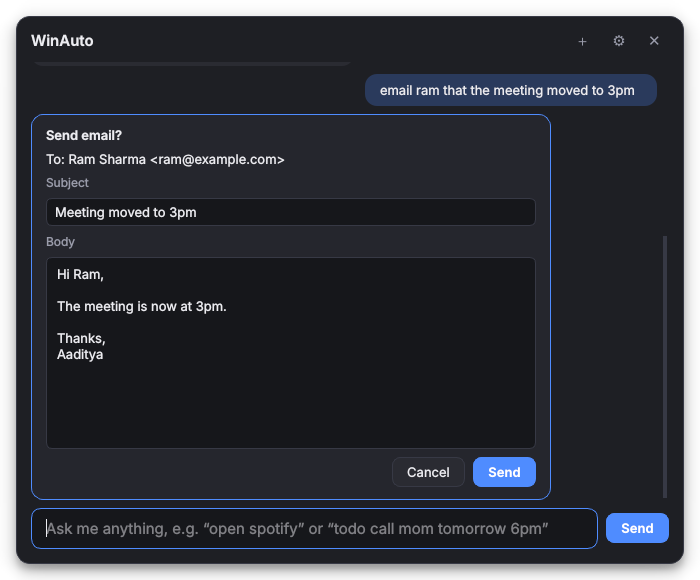

# WinAuto

A private assistant for your Windows PC. Press **Ctrl+Alt+Space**, type what you want in plain English, and it does it: opens apps, keeps your notes and todos, searches the web, controls volume and Wi-Fi, and more.

The AI runs **on your own PC** (via [Ollama](https://ollama.com)), so your requests don't go to anyone's cloud. Simple commands like `open spotify` or `volume 30` don't even need the AI; they run instantly.



## What it can do

| Area | Try saying |
|---|---|
| Apps | `open spotify` · `close chrome` · `force close zoom` · `switch to vs code` · `what apps are open` |
| Todos | `todo call mom tomorrow 6pm` · `show my todos` · `what do I have to do today` · `mark 3 done` |
| Notes | `note the wifi password is on the router` · `where's my wifi password?` · `show my notes` |
| Web | `open youtube` · `search best budget laptops` · `who won the match yesterday?` · `play lofi on youtube` |
| Weather | `what's the weather` · `will it rain tomorrow in Pokhara` |
| PC controls | `volume 30` · `mute` · `brightness 50` · `dark mode on` · `turn off bluetooth` · `lock` |
| Power | `shut down in 30 minutes` · `restart` · `cancel shutdown` · `sleep` |
| PC health | `battery` · `why is my laptop so slow` · `empty the recycle bin` |
| Quick maths | `15% of 2400` · `convert 10 km to miles` · `time in Tokyo` |

Anything that sends, deletes or shuts down shows a card first, and nothing happens until you press the button. Email and message drafts can be edited on that card before sending.

Coming next: Gmail, contacts, reminders and timers, WhatsApp, Discord, files, clipboard, media keys, window snapping, and routines.

## Setup

### 1. Install the local AI (Ollama)

1. Download and install Ollama from **https://ollama.com/download** (Windows).
2. Open **Command Prompt** and download a model:

   ```
   ollama pull qwen3:8b
   ```

   | Your graphics card memory (VRAM) | Model to use |
   |---|---|
   | 6–8 GB | `qwen3:8b` (default) |
   | 12 GB or more | `qwen3:14b` (smarter) |
   | 24 GB or more | `qwen3:32b` |

   Other models that handle tools well: `llama3.1:8b`, `mistral-nemo:12b`. If you change the model, pick it in WinAuto's **Settings**.

Ollama starts with Windows and runs in the background. LM Studio or another OpenAI-compatible server also works (Settings → Server type).

### 2. Get WinAuto

**Option A: download the app (no Python needed)**

1. Open the repository's **Actions** tab on GitHub, click the latest green **CI** run, and download **WinAuto-windows** at the bottom of the page.
2. Unzip it somewhere permanent, e.g. `C:\Apps\WinAuto`.
3. Run **WinAuto.exe**. Windows may say "Windows protected your PC" because the app isn't signed: click **More info → Run anyway**.

**Option B: run from source**

```
git clone https://github.com/AadityaX86/WinAuto
cd WinAuto
py -3.12 -m venv .venv
.venv\Scripts\activate
pip install -e .
python -m winauto
```

### 3. Use it

- Press **Ctrl+Alt+Space** to open or close the popup (changeable in Settings).
- **Esc** hides it. **Up/Down** recalls earlier commands. **＋** starts a new chat.
- The tray icon (bottom right, near the clock) has Settings, the data folder, the log file, and Quit.
- In **Settings**, tick **Start WinAuto when I sign in**, add your name (used to sign emails), and set your weather city.

## Privacy

- Your notes, todos and settings live in `%APPDATA%\WinAuto` on your PC.
- Requests go to the AI model on your own PC (Ollama). Nothing goes to an AI company.
- Web searches go to DuckDuckGo, and weather comes from wttr.in. Only the search words or city are sent.

## Troubleshooting

| Problem | Fix |
|---|---|
| "The AI model isn't running" | Start Ollama (Start menu → Ollama), or run `ollama serve` in Command Prompt. |
| "The model ... isn't downloaded" | Run `ollama pull qwen3:8b` (or the model named in Settings). |
| Slow answers | Use a smaller model, or close other GPU-heavy apps. Quick commands stay instant. |
| Hotkey doesn't work | Another app uses it. Pick another in Settings, e.g. `ctrl+shift+space`. |
| Brightness doesn't change | Brightness control only works on built-in laptop screens. |
| Something else | Tray icon → **Open log file**, and share the last lines. |

Check a packaged build with `WinAuto.exe --selftest` (writes a report to your temp folder).

## For developers

```
pip install -e ".[dev]"
python -m pytest            # set QT_QPA_PLATFORM=offscreen on a headless machine
python -m winauto --cli     # chat in the terminal, handy for testing skills
```

How it fits together:

```
winauto/
  app.py            tray icon, hotkey, popup wiring
  runtime.py        builds config, database, skills, AI client, agent
  core/
    agent.py        quick command → or AI with tools → approval → result
    llm.py          Ollama / OpenAI-compatible clients
    skill.py        Skill base class and @tool decorator
    quick.py        instant offline commands
    timeparse.py    "tomorrow 5pm", "in 10 minutes"
  skills/           one file per ability (apps, notes, web, utils, system)
  winos/            Windows API wrappers (only place with Windows-specific code)
  ui/               popup, approval cards, settings, tray
```

### Adding a skill

Create `winauto/skills/myskill.py`:

```python
from winauto.core.skill import QuickRule, Risk, Skill, ok, tool

class MySkill(Skill):
    name = "myskill"
    keywords = r"\b(coffee)\b"          # when to offer these tools to the AI

    @tool("Order a coffee.", params={"size": "small, medium or large"}, risk=Risk.CONFIRM)
    def order_coffee(self, size: str = "medium"):
        return ok(f"Ordered a {size} coffee.")

    def quick_rules(self):
        return [QuickRule(r"coffee (?P<size>small|medium|large)", lambda m: ("order_coffee", {"size": m["size"]}))]
```

Then add `("myskill", "MySkill")` to `BUILTIN` in `winauto/skills/__init__.py`. The method signature becomes the tool definition the AI sees. `Risk.CONFIRM` makes it ask first.
