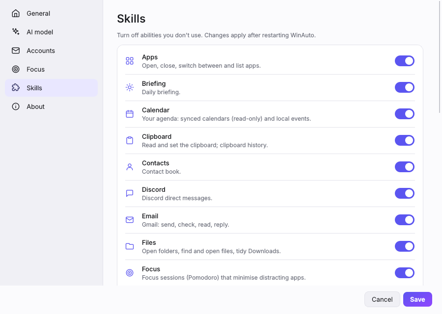

# Getting started

Set up WinAuto in about 15 minutes, most of it waiting for the AI model to download.

## What you need

- **Windows 10 or 11.**
- **A graphics card with 6 GB of memory or more** for a smooth experience (NVIDIA, AMD or Intel Arc). WinAuto works on a CPU too, just slower. Instant commands like "open spotify" don't need the AI at all.
- **About 6 GB of free disk space** for the default model.

## 1. Install the AI model (Ollama)

WinAuto's AI runs on your own PC through [Ollama](https://ollama.com).

1. Download and install Ollama from **https://ollama.com/download**.
2. Open **Command Prompt** and download the default model:

   ```
   ollama pull qwen3:8b
   ```

3. Optional, for questions about your screen:

   ```
   ollama pull qwen2.5vl:7b
   ```

Ollama starts with Windows and runs in the background. Have a bigger or smaller graphics card? See [AI models](ai-models.md) for which model to pick.

## 2. Get WinAuto

### Option A: download the app (no Python needed)

1. On GitHub, open the repository's **Actions** tab and click the latest green **CI** run on `main` (you need to be signed in to GitHub to download).
2. At the bottom, under **Artifacts**, download **WinAuto-windows**.
3. Unzip it somewhere permanent, for example `C:\Apps\WinAuto`.
4. Run **WinAuto.exe**. Windows may say "Windows protected your PC" because the app isn't signed: click **More info → Run anyway**.

### Option B: run from source

Install [Python 3.12](https://www.python.org/downloads/) and [Git](https://git-scm.com/download/win), then:

```
git clone https://github.com/AadityaX86/WinAuto
cd WinAuto
py -3.12 -m venv .venv
.venv\Scripts\activate
pip install -e .
python -m winauto
```

## 3. First run

WinAuto opens with a short welcome message and puts an icon in the system tray (bottom right, near the clock; it may be under the **^** arrow).

- **Ctrl+Alt+Space** opens and closes WinAuto from any app.
- **Ctrl+Alt+T** opens writing tools for text you've selected in any app.
- The tray icon's menu has Settings, the data folder, the log file and Quit.

The dot at the bottom left of the popup turns green when the AI model is ready. If Ollama isn't running, WinAuto tries to start it, and tells you what to do if it can't.

## 4. Try it

Press **Ctrl+Alt+Space** and type:

| Try | What happens |
|---|---|
| `notepad` | Notepad appears as a result as you type; Enter opens it |
| `volume 30` | Sets the volume instantly |
| `todo call mom tomorrow 6pm` | Adds a todo with a due date |
| `remind me to stretch in 20 minutes` | A notification in 20 minutes |
| `what's the weather` | The weather where you are |
| `who won the last football world cup?` | The AI searches the web and answers |
| select text in any app, then **Ctrl+Alt+T** | Fix grammar, rewrite, translate, summarize |

## 5. Make it yours

Open **Settings** (the sliders button in the popup, or the tray menu):

- **General:** your name (used when writing emails), your city for weather, the theme, **Start with Windows**.
- **AI model:** pick a different model (**Find installed** lists what Ollama has), then **Test connection**.
- **Accounts:** Gmail, WhatsApp country code and calendar links ([how](connect-accounts.md)).
- **Skills:** turn off anything you don't need.



## Next

- [User guide](user-guide.md): everything you can say and do
- [Connect your accounts](connect-accounts.md): Gmail, WhatsApp, Discord, calendar, contacts
- [Troubleshooting](troubleshooting.md): if something doesn't work
