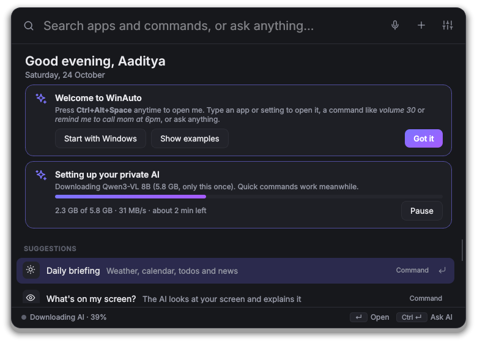

# Getting started

Download WinAuto, run it, and it sets up its own AI. There's nothing else to install.

## What you need

- **Windows 10 or 11.**
- **About 8 GB of free disk space** for the AI model, which WinAuto downloads once on first run (3–6 GB depending on your PC).
- **A graphics card with 6 GB of memory or more** for quick answers (NVIDIA, AMD or Intel). Without one the AI runs on the processor: it works, just more slowly. Instant commands like "open spotify" don't need the AI at all.

## 1. Get WinAuto

### Option A: download the app (no Python needed)

1. Open the **[latest release](https://github.com/AadityaX86/WinAuto/releases/latest)** and download one of:
   - **WinAuto-*version*-windows.zip** (recommended): unzip it somewhere permanent, for example `C:\Apps\WinAuto`, and run **WinAuto.exe** inside. It starts faster.
   - **WinAuto-*version*.exe**: the same app as one file, nothing to unzip. Put it somewhere permanent before turning on "Start with Windows".
2. Windows may say "Windows protected your PC" because the app isn't signed: click **More info → Run anyway**.

Builds of the very latest code are also on the repository's **Actions** tab (latest green **CI** run on `main` → **Artifacts** → **WinAuto-windows**; you need to be signed in to GitHub).

### Option B: run from source

Install [Python 3.12](https://www.python.org/downloads/) and [Git](https://git-scm.com/download/win), then:

```
git clone https://github.com/AadityaX86/WinAuto
cd WinAuto
py -3.12 -m venv .venv
.venv\Scripts\activate
pip install -e .
python -m winauto
```

## 2. First run: WinAuto sets up its AI

WinAuto opens and puts an icon in the system tray (bottom right, near the clock; it may be under the **^** arrow). A **Welcome** card on the home screen has two handy buttons: **Start with Windows**, so the shortcut works as soon as you sign in, and **Show examples**. Press **Got it** when you're done with it.

On the home screen a card shows WinAuto **downloading its AI** (only this once). It picks the model that suits your graphics card: **Qwen3-VL 8B** (5.8 GB) for 8 GB cards and up, otherwise **Qwen3-VL 4B** (3.0 GB). Both chat, use WinAuto's tools and understand screenshots. The card shows progress and time left. **Pause** stops it, and it continues where it left off, even after a restart. Instant commands work while it downloads. When it's done the AI loads, the dot at the bottom left turns green and Windows shows a "Your AI is ready" notification, so you can close the popup and carry on meanwhile.



Prefer Ollama or another AI server you already use? Choose it in **Settings → AI model** ([details](ai-models.md#using-ollama-instead)).

- **Ctrl+Alt+Space** opens and closes WinAuto from any app.
- **Ctrl+Alt+T** opens writing tools for text you've selected in any app.
- The tray icon's menu has Settings, the data folder, the log file and Quit.

## 3. Try it

Press **Ctrl+Alt+Space** and type:

| Try | What happens |
|---|---|
| `notepad` | Notepad appears as a result as you type; Enter opens it |
| `volume 30` | Sets the volume instantly |
| `todo call mom tomorrow 6pm` | Adds a todo with a due date |
| `remind me to stretch in 20 minutes` | A notification in 20 minutes |
| `what's the weather` | The weather where you are |
| `who won the last football world cup?` | The AI searches the web and answers |
| select text in any app, then **Ctrl+Alt+T** | Fix grammar, rewrite, translate, summarize |
| `help` | Examples of everything you can type |

Don't remember the wording? Type the first few letters, like `rem` or `email`, and pick a **Fill in** result: it starts the command for you ("remind me to …") with an example of how to finish it.

## 4. Make it yours

Open **Settings** (the sliders button in the popup, or the tray menu):

- **General:** your name (used when writing emails), your city for weather, the theme, **Start with Windows**.
- **AI model:** switch between the standard and small built-in model, or use Ollama instead.
- **Accounts:** Gmail, WhatsApp country code and calendar links ([how](connect-accounts.md)).
- **Skills:** turn off anything you don't need.


## Next

- [User guide](user-guide.md): everything you can say and do
- [Connect your accounts](connect-accounts.md): Gmail, WhatsApp, Discord, calendar, contacts
- [Troubleshooting](troubleshooting.md): if something doesn't work
