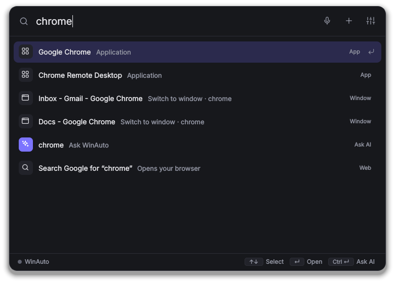

# User guide

Everything WinAuto can do, and how to get the most out of it. New here? Start with [Getting started](getting-started.md).

## The launcher

Press **Ctrl+Alt+Space** from any app. The popup opens on the **home screen**:
- a greeting
- today's cards (todos due, your next reminder or meeting, the weather)
- suggestions
- your recent commands

Start typing and **results appear as you type**: apps, settings pages, websites, files, calculations, emoji, clipboard items, your quick links and snippets, and an **Ask WinAuto** row that sends what you typed to the AI.



| Key | Does |
|---|---|
| ↑ ↓ | Move through results (in a chat: go back through what you typed) |
| **Enter** | Run the selected result, or send your sentence |
| **Ctrl+Enter** | Send to the AI even if a result is selected |
| **Esc** | Clear the box; press again to hide |
| **Ctrl+Alt+T** | Writing tools for the text selected in any app (see below) |

Next to the search box, **mic** starts Windows voice typing, **＋** starts a new chat and **sliders** open Settings. The dot at the bottom left is green when the AI model is ready.

Results that open something (an app, a website) hide the popup afterwards. Results that copy something show "✓ Copied" and hide.

### Prefixes

| Type | Get |
|---|---|
| `> ipconfig` | Run a terminal command (asks first). Start with `ps` for PowerShell. |
| `:party` or `emoji party` | Emoji, Enter copies it |
| `/resume` | Files by name |
| `clip` | Clipboard history |
| `#ff8800`, `rgb(255,136,0)` | Colour in hex, RGB and HSL, Enter copies it |
| `12*7`, `15% of 2400`, `10 km to miles` | The answer right away, Enter copies it |

## Asking in plain English

Type a sentence and press Enter. Two things can happen:

1. **Instant commands.** Common requests ("open spotify", "volume 30", "todo buy milk") are recognised directly and run straight away, even without the AI.
2. **The AI.** Everything else goes to the model on your PC. It picks the right tools, runs them, and answers. Answers appear as they're written.

Follow-ups work: "email Ram that I'm late" → "actually say 15 minutes". **＋** starts a fresh chat, and the stop button cancels what's running.

### Approval cards

Anything that **sends, deletes, runs a command or shuts down** shows a card first, and nothing happens until you press the button. Drafts (emails, messages, commands) can be edited right on the card.


## What you can say

Examples marked with **AI** need the model; the rest run instantly. You don't have to use these exact words.

### Apps and windows

| Say | |
|---|---|
| `open spotify` · `close chrome` · `switch to vs code` | Open, close or switch to apps (typos are fine) |
| `force close zoom` | Kill a frozen app (asks first) |
| `what apps are open` | List open windows |
| `snap chrome left` · `maximize` · `put chrome and vs code side by side` | Arrange windows ("maximize" alone means the window you were just in) |
| `minimize everything` · `bring back my windows` | Show the desktop and back |
| `take a screenshot` · `screenshot of this window` · `snip` | Saved to Pictures\Screenshots; `snip` lets you draw a box |

### Todos, notes and reminders

| Say | |
|---|---|
| `todo call mom tomorrow 6pm` · `todo pay rent friday` | Add a todo with a due date |
| `show my todos` · `what do I have to do today` · `what's overdue` (**AI**) | See todos |
| `mark 3 done` · `delete todo 3` (**AI**) | Finish or remove one |
| `note the wifi password is on the router` | Save a note |
| `where's my wifi password?` (**AI**) | Search your notes and answer |
| `remind me to call mom at 6pm` · `remind me to stretch in 20 minutes` | One-off reminders, shown as notifications |
| `remind me to drink water every day at 10am` | Repeating (daily, weekdays, weekly, monthly) |
| `pasta timer 8 min` · `stop the timer` | Timers |

### Calendar and your day

| Say | |
|---|---|
| `what's on my calendar tomorrow` · `what's my next meeting` | Your agenda (Google/Outlook via a private link; see [Connect your accounts](connect-accounts.md#calendar)) |
| `add dentist friday 3pm to my calendar` (**AI**) | Local event, with a reminder 10 minutes before |
| `good morning` · `brief me` | Daily briefing: weather, calendar, todos, reminders, unread email, headlines. Also shown the first time you open WinAuto each morning (turn off in Settings). |
| `focus for 50 minutes` · `start pomodoro x 4` · `stop focus` | Focus sessions with breaks. Apps on your list (Discord, Steam…) are minimised while you focus. |

### Email, messages and contacts

| Say | |
|---|---|
| `email Ram that the meeting moved to 3pm` (**AI**) | Draft, edit on the card, then **Send** |
| `check my email` · `emails from Sita` · `search my email for invoices` | Recent or matching emails |
| `read the email from Sita` · `reply to the last one saying thanks` (**AI**) | Read and reply |
| `whatsapp mom: reached home` · `tell Ram I'm 10 minutes late on WhatsApp` | WhatsApp Desktop opens with the message typed, sent after you approve |
| `discord didi: are you on tonight?` | Discord DM, same way |
| `add contact Ram Sharma ram@example.com +977 9800000000` · `what's Sita's number` | Contacts |
| `import contacts from C:\Users\you\Downloads\contacts.csv` (**AI**) | Import a Google Contacts export (.csv or .vcf) |

Setting these up: [Connect your accounts](connect-accounts.md).

### Web and information

| Say | |
|---|---|
| `open youtube` · `open github.com` | Websites (add your own names in [settings](configuration.md#settings-only-in-configjson)) |
| `search best budget laptops` | Opens a web search |
| `who won the match yesterday?` (**AI**) | Searches the web and answers, naming the source |
| `what's the weather` · `will it rain tomorrow in Pokhara` | Weather |
| `100 usd to npr` · `convert 10 km to miles` · `time in Tokyo` | Live exchange rates, units, world clock |
| `define serendipity` · `wiki kathmandu` · `news about cricket` | Dictionary, Wikipedia, headlines |

### Writing tools (any app)

Select text anywhere (an email, a document, a chat box) and press **Ctrl+Alt+T**. WinAuto shows the text and one-click actions:
- fix grammar
- make formal or casual
- shorter or longer
- summarize
- bullet points
- translate
- explain
- draft a reply

You can also type your own instruction ("make it sound more confident"). Then press **Replace selection** to paste the result over the original, or **Copy**.


The same actions work on what you copied: `fix the grammar`, `summarize this`, `translate this to nepali`. Your clipboard is put back the way it was afterwards.

### Your screen and images

| Say | |
|---|---|
| `what's on my screen?` · `explain this error` | Takes a screenshot and asks the vision model |
| `read the text on my screen` | Copies all readable text (like OCR) |
| `what's in C:\Users\you\Pictures\receipt.jpg?` (**AI**) | Questions about an image file |

The built-in AI understands screenshots out of the box (with Ollama you need a vision model; see [AI models](ai-models.md#using-ollama-instead)). Screenshots are not saved.

### Memory

`remember that my sister's name is Sita` saves a fact that the AI is told in every conversation, so "message my sister" just works. `what do you know about me` lists them; `forget my sister` removes one. ("remember to buy milk" still makes a note.)

### Clipboard, quick links and snippets

| Say | |
|---|---|
| `clipboard history` · `copy 2` | Recently copied text (kept in memory only) |
| `add quicklink gh https://github.com/search?q={query}` then `gh winauto` | Your own shortcuts; `{query}` is replaced by what you type after the name |
| `save snippet address: 12 Lake Road, Pokhara` then `paste address` | Text you type often, pasted into the app you were in. Placeholders: `{date}`, `{time}`, `{day}`, `{year}`, `{clipboard}` |

### Files

| Say | |
|---|---|
| `open downloads` · `open my documents folder` | Folders |
| `find my resume pdf` · `open the budget spreadsheet` (**AI**) | Search your folders |
| `organize my downloads` | Sort Downloads into Images, Documents, Videos… (asks first) |
| `what's taking up space` | Biggest files |

### PC controls

| Say | |
|---|---|
| `volume 30` · `mute` · `brightness 50` | Sound and screen (brightness works on laptop screens) |
| `dark mode on` · `turn off bluetooth` · `wifi off` | Settings toggles |
| `bluetooth settings` · `open display settings` | Jump to a Settings page |
| `lock` · `sleep` · `restart` · `shut down in 30 minutes` · `cancel shutdown` | Power (shutting down asks first) |
| `battery` · `why is my laptop so slow` | Battery, CPU, memory, disk and what's using the most |
| `empty the recycle bin` · `clean up temp files` | Free space (asks first) |

### Music and video

`pause` · `next song` · `previous track` · `what's playing` work with any player (Spotify, YouTube in a browser, Media Player…). `play lofi beats` plays the top YouTube result; `play jazz on spotify` opens Spotify's search.

### Routines

Chain commands you run together:

```
create a routine called work mode that opens vs code, opens slack and sets volume to 20
```

Then just say `work mode`. Steps can include waits (`wait 5 seconds`). `show my routines` lists them. Steps that send or delete still ask first.

### Little tools

`generate a password` (copied for you) · `pick a colour` (point at any pixel) · `what's my ip` · `read this aloud` / `stop reading` · `> ping google.com`.

## Tips

- **Recent commands** on the home screen re-run with Enter.
- Put your name, city and preferred music service in **Settings → General**; the AI uses your name when writing for you.
- Turn off skills you never use in **Settings → Skills**. It keeps the AI a little faster.
- Every tool, with its exact options, is listed in the [skills and tools reference](skills.md).
